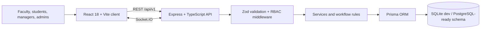

# UniSync

UniSync is an inter-departmental planning and resource-sharing workspace for colleges. It brings shared spaces, equipment, bookings, campus events, and cross-functional projects into one calm, searchable interface.

## What is included

- Responsive workspace with role-aware navigation concepts, light/dark themes, global command search, notification popover and accessible keyboard focus.
- Dashboard KPIs, resource utilization trend, attention queue, recent booking activity, project progress, and campus pulse.
- Resource inventory search and category filters, utilization, ownership and booking entry points.
- Booking request API with overlap detection, ordered resource-manager/HOD approvals, decision notifications, and in-app Socket.IO events.
- Department directory, project portfolio, month calendar, events, analytics and admin settings views.
- Express REST API with JWT access/refresh cookies, bcrypt passwords, centralized RBAC middleware, Zod request validation, pagination, auth rate limits, Helmet, CORS, and Swagger UI.
- Prisma schema with SQLite development storage and relations/indexes covering identity, departments, inventory, availability, bookings, approvals, projects, tasks, events, notifications, collaboration, maintenance, audit and settings.
- Demo seed creates 6 departments, 25 users, 42 resources, 64 bookings, 8 projects with tasks and milestones, 10 events, announcements and notifications.

## Screenshots

Screenshots can be added here after launching the local app:

- `docs/screenshots/dashboard.png`
- `docs/screenshots/resources.png`
- `docs/screenshots/calendar.png`

## Architecture



## Requirements

Node.js 20+ and npm 10+. The repository uses npm workspaces. SQLite is the default local database. For PostgreSQL, change the Prisma datasource provider to `postgresql` and set `DATABASE_URL` to your PostgreSQL connection string.

## Setup

```bash
cp .env.example .env
npm install
npm run db:generate -w server
npm run db:migrate -w server -- --name init
npm run db:seed
npm run dev
```

Open [http://localhost:5173](http://localhost:5173) for the app, [http://localhost:4000/api/docs](http://localhost:4000/api/docs) for OpenAPI/Swagger, and [http://localhost:4000/api/v1/health](http://localhost:4000/api/v1/health) for API health.

`npm run dev` starts the Vite app and Express API concurrently. Copy the environment file before the first migration. The seed is deterministic and resets the demo database tables it owns.

## Demo credentials

All seeded accounts use `Password@123`.

| Role | Email |
|---|---|
| Super Admin | `admin@unisync.edu` |
| Department Head (CSE) | `maya.iyer@unisync.edu` |
| Faculty | `ananya@unisync.edu` |
| Student Coordinator | `coord1@unisync.edu` |
| Resource Manager | `lab.cse@unisync.edu` |

The browser interface currently opens directly into the demo workspace to make evaluation frictionless; API login and role enforcement are available for client integration.

## API overview

All routes are versioned under `/api/v1`. Success bodies use `{ "data": ... }`; errors use `{ "error": { "code", "message", "details?" } }`.

| Method | Route | Access | Purpose |
|---|---|---|---|
| GET | `/health` | Public | Health check |
| POST | `/auth/login` | Public, rate limited | Login and set access/refresh cookies |
| POST | `/auth/register` | Public, rate limited | Create account awaiting admin approval |
| POST | `/auth/refresh` | Refresh cookie | Refresh access cookie |
| POST | `/auth/logout` | Public | Clear session cookies |
| GET | `/me` | Signed in | Current profile |
| GET | `/departments` | Public | Department directory |
| GET | `/resources?page=&limit=&q=&departmentId=&categoryId=&status=` | Public | Filtered resource inventory |
| POST | `/resources` | Admin, HOD, resource manager | Create resource |
| GET | `/bookings` | Signed in | List bookings |
| POST | `/bookings` | Signed in | Request booking, reject overlaps with HTTP 409 |
| POST | `/bookings/:id/decision` | Approver role | Approve/reject an approval step |
| GET | `/projects`, `/events` | Public | Project and event lists |
| GET | `/notifications` | Signed in | Current user's notifications |
| GET | `/analytics/summary` | Admin, HOD | Summary counts |

## Assumptions and scope notes

- This starter uses SQLite for zero-service local setup. The Prisma models use portable scalar types and can be moved to PostgreSQL with a datasource/migration change.
- The frontend is preloaded into a demo workspace rather than gating the UI behind login. Authentication endpoints and RBAC middleware are implemented server-side; production deployment should wire session bootstrap to the UI.
- Email delivery and password reset are mocked by design; connect a mail provider and tokenized reset store before production use.
- Resource images and request attachments are modeled as metadata and represented by local visual placeholders in the demo; connect object storage before accepting uploads.
- The app seeds a representative 42-item inventory (rather than the requested 40+ threshold only) and 64 bookings so list and analytics screens have immediate content.
- Approval order is resource manager then owning department HOD where those users exist. `OPEN` resources are immediately approved; private resources reject cross-department requests.
- UI data is curated in `client/src/lib/data.ts` for rich, deterministic presentation. The REST API is independently usable and is the integration point for connecting live data throughout the UI.

## Tests and build

```bash
npm test
npm run build
```

Booking overlap and multi-step approval decisions have focused unit tests. Add API integration tests around auth, permissions and database transactions as deployment requirements become concrete.

## Future Scope

- AI-assisted resource and time-slot recommendations using utilization, equipment and project context.
- Native mobile apps for student event registration and booking notifications.
- Integration with campus ERP, identity provider, finance and learning-management systems.
